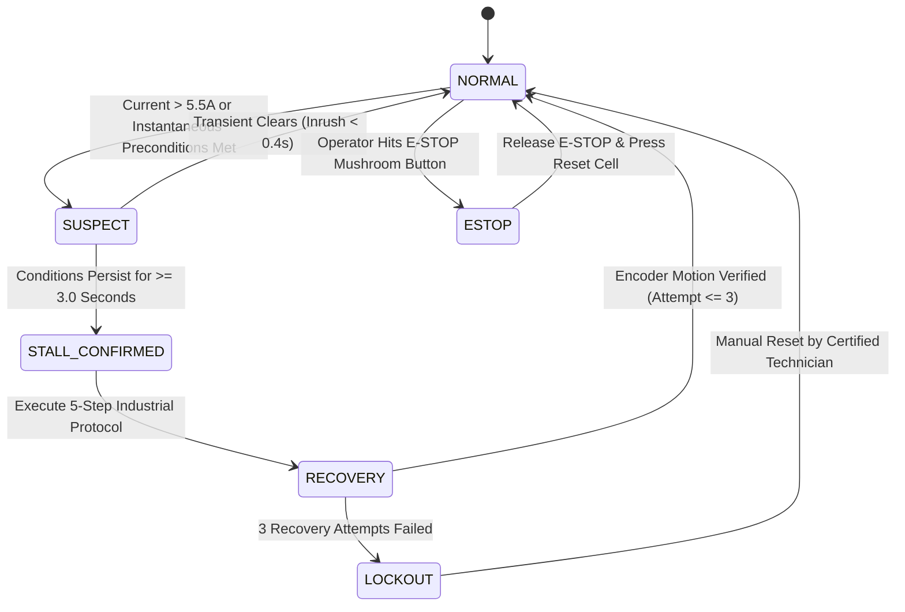

# TORQUEGUARD 3D
### Intelligent Motor Stall Detection, Overload Protection and Safe Recovery System
**Project Category:** Embedded Systems Software Simulation (3D Digital Twin)  
**Target Architecture:** ARM Cortex-M4 (STM32F401 / ESP32 Industrial Node) with FreeRTOS  
**Visualization Engine:** Three.js Procedural 3D WebGL Digital Twin & Industrial SCADA Interface  

---

## 1. Executive Summary

In industrial manufacturing plants, motorized conveyor actuators move cargo continuously. When an object jams between rollers or guides, the motor shaft seizes while continuous bus voltage is applied. Without back-EMF ($K_e \cdot \omega = 0$), armature current surges dramatically, generating intense Joule heating ($I^2 R$) that can destroy motor windings, damage power MOSFETs, and create fire hazards.

Traditional overcurrent protection relies on simple current thresholds. However, **DC motors naturally draw 3× to 5× their rated current during startup** (inrush current) before the rotor accelerates. Simple thresholding leads to frequent false alarms and unnecessary production downtime.

**TorqueGuard 3D** solves this fundamental embedded challenge by implementing an **intelligent multi-factor stall detection gate** combined with an **automated 5-step safe recovery protocol**. It distinguishes flawlessly between:
1. **Normal Startup Inrush** (High current ~7.5A, low speed, but lasts < 0.4s) $\rightarrow$ *Filtered out by debounce persistence timer*.
2. **Heavy Operational Load** (Current ~4.2A, speed ~70 RPM, Position Error ~15%) $\rightarrow$ *Operates safely within limits without false trips*.
3. **Actual Mechanical Jam / Stall** (Current > 6.0A, Speed < 5 RPM, Zero encoder pulses, Position Error > 25%, persists > 3.0s) $\rightarrow$ *Confirmed stall triggers immediate PWM cutoff, cooling delay, reverse torque dislodge, and forward verification*.

---

## 2. 3D Digital Twin Visual Components

The 3D industrial simulation is constructed procedurally using Three.js with full PBR materials, dynamic shadows, and live state animation:

| Component | 3D Visualization Details | Embedded & Electrical Role |
| :--- | :--- | :--- |
| **24V DC Motor** | Cast-iron stator housing, 12 radial heat-dissipation fins, rear fan shroud with spinning blades, junction box. Features **live thermal glow** and vibration jitter under locked rotor. | Actuator prime mover (Rated: 24V DC, 2.5A nominal, 5A safe max, 6A critical). |
| **Reduction Gearbox** | Heavy-duty 15:1 planetary gearbox with flexible spider coupling connecting to drive roller. | Torque multiplier ($\tau_{out} = \tau_{motor} \times 15$). |
| **Optical Rotary Encoder** | Omron E6B2-style cylindrical housing with transparent inspection window showing the slotted optical disc rotating, plus an active green LED that pulses with encoder ticks. | Provides quadrature position and velocity feedback ($\Delta \text{pulses}/\Delta t$) via MCU hardware timer in QEI mode. |
| **ACS712 Current Sensor** | Polycarbonate DIN enclosure with copper busbars and an active LED that glows brighter with current (Cyan $\rightarrow$ Amber $\rightarrow$ Red). | Hall-effect isolated analog current transducer sampled by ADC via DMA. |
| **PT100 RTD Temp Probe** | Stainless steel thermowell screwed into the motor stator core with high-temp red silicone lead wire. | Measures motor core temperature with lumped capacitance thermal response. |
| **Conveyor Belt & Rollers** | Textured rubber belt with UV scrolling, crowned head drive roller, tail idler roller, snub return rollers, and aluminum T-slot frame. | Translates rotational torque into linear parcel displacement ($v = \omega \cdot r$). |
| **Cargo & Jam Obstruction** | Cardboard boxes with barcodes and shipping labels. An oversized steel obstruction wedge drops at the pinch point upon manual or automated fault injection. | Models cargo flow and mechanical pinch point seizure. |
| **Andon Stack Light** | 3-tier signal tower (Red, Amber, Green) and acoustic horn mounted atop the Rittal control cabinet. | Visual factory indication (Green = Normal, Amber = Suspect/Stall, Red Flashing = Lockout/E-Stop). |
| **FLIR Thermal Vision** | Toggleable false-color infrared heatmap shader displaying motor core thermal gradients (Blue 35°C $\rightarrow$ Green 50°C $\rightarrow$ Yellow 65°C $\rightarrow$ White-hot 85°C+). | Simulates industrial preventive maintenance thermal imaging. |

---

## 3. Intelligent Stall Detection Algorithm

TorqueGuard evaluates a **5-Factor Boolean Gate Matrix**. A stall condition is **NEVER** declared based on current alone.

$$\text{STALL CONFIRMED} \iff \Big( I > 6.0\text{A} \Big) \land \Big( \omega < 5.0\text{ RPM} \Big) \land \Big( \Delta \text{Encoder} = 0 \Big) \land \Big( E_{pos} > 25\% \Big) \land \Big( \Delta t_{\text{persist}} \ge 3.0\text{s} \Big)$$

```
+-----------------------------------------------------------------------------------+
|                            TORQUEGUARD 5-FACTOR GATE MATRIX                       |
|                                                                                   |
|  [Condition 1]  Armature Current > 6.0 A?            ------------------+          |
|  [Condition 2]  Motor Speed < 5.0 RPM?               ------------------+          |
|  [Condition 3]  Optical Encoder Delta == 0?          ------------------+---> AND  |
|  [Condition 4]  Position Error > 25%?                ------------------+          |
|  [Condition 5]  Condition Persists for >= 3.0s?      ------------------+          |
|                                                                         |         |
|  RESULT: If Inrush (< 0.4s) -> FILTERED / REJECTED (NORMAL State)      |         |
|          If Persists (>= 3.0s) -> TRIP PWM & ENTER RECOVERY            v         |
|                                                               [STALL CONFIRMED]   |
+-----------------------------------------------------------------------------------+
```

---

## 4. Finite State Machine (FSM) & 5-Step Recovery Strategy

The firmware implements a deterministic state machine with visual and acoustic feedback:



### Automated 5-Step Recovery Sequence
1. **Step 1: Immediate PWM Cutoff (100ms)**  
   H-Bridge gate drives disabled and safety contactor opened immediately to arrest Joule heating ($I^2 R$) and prevent thermal runaway.
2. **Step 2: Thermal & Inductive Cooldown (2.0s)**  
   System pauses to allow motor inductive back-EMF to collapse and rotor heat to begin conductive transfer into cooling fins.
3. **Step 3: Reversal Torque Dislodge (1.0s @ -30 RPM)**  
   H-Bridge reverses polarity, applying reverse torque to back the jammed package away from the roller pinch point.
4. **Step 4: Controlled Forward Restart (1.5s @ +100 RPM)**  
   Motor restarts in normal forward direction under gentle acceleration ramp.
5. **Step 5: Motion Verification via Optical Encoder (1.0s Window)**  
   MCU verifies whether incremental encoder pulse frequency exceeds 40 RPM:
   - **If Motion Verified:** Return system to **NORMAL** with green beacon and acoustic success chime.
   - **If Motion Fails:** Increment retry counter (`attemptCount++`). If `< 3`, repeat from Step 1. After **3 failed attempts**, trigger **LOCKOUT** with emergency red strobe, continuous dual-tone siren, and latch safety disconnect.

---

## 5. Mathematical & Electro-Mechanical Models

### 5.1 DC Motor Dynamics & Inrush Current
The motor electrical and mechanical state is governed by coupled differential equations:

$$V_{bus}(t) = I(t) \cdot R_a + L_a \frac{dI}{dt} + K_e \cdot \omega_{rotor}(t)$$

$$\tau_{em}(t) = K_t \cdot I(t)$$

$$J_{eq} \frac{d\omega_{rotor}}{dt} = \tau_{em}(t) - \frac{\tau_{load}}{G_{ratio}} - b \cdot \omega_{rotor}(t)$$

When the motor starts from rest ($\omega = 0$), $K_e \cdot \omega = 0$. The initial inrush current is limited solely by $R_a = 1.2\Omega$:

$$I_{inrush, peak} \approx \frac{V_{bus}}{R_a} \approx \frac{24\text{V}}{1.2\Omega} = 20\text{A (Theoretical Peak)}$$

With power supply soft-start impedance, real-world peak inrush reaches $\approx 7.5\text{A}$ for $0.2-0.35$ seconds. **TorqueGuard's 3.0s debounce timer prevents false trips during this normal startup surge.**

### 5.2 Lumped Parameter Thermal ODE (Newton's Cooling)
The motor thermal state follows:

$$\frac{dT_{motor}}{dt} = \frac{I(t)^2 \cdot R_a}{C_{th}} - \frac{T_{motor}(t) - T_{ambient}}{R_{th} \cdot C_{th}}$$

- At normal load ($I = 2.42\text{A}$): Joule dissipation $P = 2.42^2 \times 1.2 = 7.02\text{W}$. Steady-state temperature stabilizes at $\approx 42^\circ\text{C}$.
- At locked-rotor stall ($I = 7.4\text{A}$): Joule dissipation surges to $P = 7.4^2 \times 1.2 = 65.7\text{W}$ ($9.3\times$ higher!).
- Crucially, the internal fan stops spinning ($\omega = 0$), increasing thermal resistance $R_{th}$ and leading to rapid thermal runaway toward the $80^\circ\text{C}$ burn threshold.

---

## 6. Embedded Firmware Implementation (FreeRTOS Architecture)

The software architecture is structured across modular FreeRTOS tasks on an ARM Cortex-M4 MCU:

| Task Name | Priority | Frequency | Peripheral / Driver | Responsibility |
| :--- | :---: | :---: | :---: | :--- |
| `vTaskSensorAcquisition` | Real-Time (5) | 1 kHz | ADC1 + Circular DMA | Samples ACS712 Hall-effect sensor with 16× oversampling filter. |
| `vTaskEncoderOdometry` | High (4) | 500 Hz | TIM2 32-bit QEI Hardware | Decodes Channel A/B 90° quadrature pulses from 1024 PPR optical disc. |
| `vTaskStallDetection` | Medium-High (3) | 100 Hz | Software Logic Gate | Evaluates 5-factor stall matrix and debounce persistence timer. |
| `vTaskRecoveryFSM` | Medium (2) | 50 Hz | TIM1 PWM + GPIO H-Bridge | Orchestrates 5-step safe recovery sequence (Stop, Wait, Reverse, Restart, Verify). |
| `vTaskSCADATelemetry` | Low (1) | 20 Hz | UART / USB-CDC / WebSockets | Transmits live telemetry (Current, Temp, RPM, Position Error) to HMI. |

---

## 7. Viva & Examination Q&A Cheat Sheet

### Q1: Why can't we use a simple overcurrent fuse or threshold for stall detection?
> **Answer:** DC motors naturally draw a high inrush current ($3\times$ to $5\times$ rated current) during startup because back-EMF ($K_e \cdot \omega$) is zero when the rotor is stationary. A simple threshold would trip every time the conveyor starts, halting production. TorqueGuard combines current measurement with optical encoder velocity, position error, and a 3-second debounce persistence timer to filter out inrush spikes while catching real mechanical jams.

### Q2: What is the purpose of the 1-second motor reversal during recovery?
> **Answer:** Reversing the motor applies counter-torque to the drive roller and belt. In an industrial conveyor, jammed parcels wedge tightly between the guide rail and roller pinch point. Reverse rotation pulls the parcel backward away from the pinch point, breaking mechanical friction and allowing gravity or guide funnels to dislodge the obstruction.

### Q3: Why does the system limit recovery retries to 3 before entering Lockout?
> **Answer:** If an obstruction cannot be dislodged in 3 attempts, it indicates a severe mechanical failure (e.g., fallen metal wedge, gear tooth failure, or bearing seizure). Continuing automated restarts would repeatedly subject the motor to locked-rotor stall current (7.5A+), causing thermal degradation of winding insulation ($T > 85^\circ\text{C}$) and risk of fire. Emergency Lockout cuts all power, sounds an alarm, and mandates manual inspection by a technician.

### Q4: How does the optical quadrature encoder measure direction and speed?
> **Answer:** The encoder generates two square waves (Channel A and Channel B) shifted by 90° in phase (quadrature). In forward rotation, Channel A leads Channel B; in reverse rotation, Channel B leads Channel A. By feeding both channels into an MCU timer configured in QEI (Quadrature Encoder Interface) mode, the hardware automatically counts up or down on every edge (4× resolution = 4096 counts/rev) without CPU loading. Velocity is computed by sampling count deltas over a fixed timer window ($\Delta \text{ticks} / \Delta t$).

---

## 8. How to Launch & Run the Digital Twin

### Option 1: 1-Click Windows Launcher (Recommended)
Double-click the included batch script:
```
start_simulation.bat
```
This automatically boots the local HTTP server and opens your default browser at `http://localhost:8080/index.html`.

### Option 2: Python Terminal Command
```bash
python server.py
```

### Option 3: Direct Web Browser
Double-click `index.html` to open directly in any modern browser (Chrome, Edge, Firefox). The project is completely self-contained with offline Three.js libraries included in `lib/`.

---

## 9. Viva Demonstration Script (Live Presentation Steps)

During your project demonstration or viva review, use the **4 Viva Demonstration Presets** in the SCADA sidebar:

1. **Click `[Demo 1: Normal Run]`**:
   - Observe smooth conveyor travel at 100 RPM.
   - Point out the initial inrush current spike (~7.5A) on the oscilloscope that decays safely in 0.3s without triggering an alarm.
   - Show steady-state operation at 2.42A, 38°C, and Green Stack Light.
2. **Click `[Demo 2: Heavy Load]`**:
   - Cargo increases to 45kg. Speed reduces to 70 RPM, current increases to 4.2A, position error rises to ~15%.
   - Explain that all parameters remain safely below the 6.0A and 25% stall boundaries, demonstrating zero false alarms under legitimate production loads.
3. **Click `[Demo 3: Auto-Recovery]`**:
   - A box jams against the roller pinch point.
   - Show the 5-Factor Gate Matrix: Current spikes to 7.3A, RPM drops to 0, encoder delta is 0, position error hits 100%.
   - Watch the **3.0s Debounce Persistence Progress Bar** count up.
   - System confirms stall, activates buzzer, cuts PWM, waits 2.0s cooldown, reverses conveyor for 1.0s to dislodge parcel, restarts forward, confirms encoder pulses, and safely restores Green NORMAL state!
4. **Click `[Demo 4: Lockout 3x]`**:
   - Injects a permanent jam.
   - System executes Attempt 1, Attempt 2, and Attempt 3.
   - On the 3rd failure, system enters **EMERGENCY LOCKOUT**: red flashing beacon, high-intensity emergency siren, contactor cutoff, and requires technician to press **`[RESET CELL]`**.
5. **Click `[Viva / Theory Explainer]`** (Top right header):
   - Opens the modal showing the production-grade Embedded C firmware, Back-EMF / Thermal differential equations, and STM32 hardware pinout mapping.
